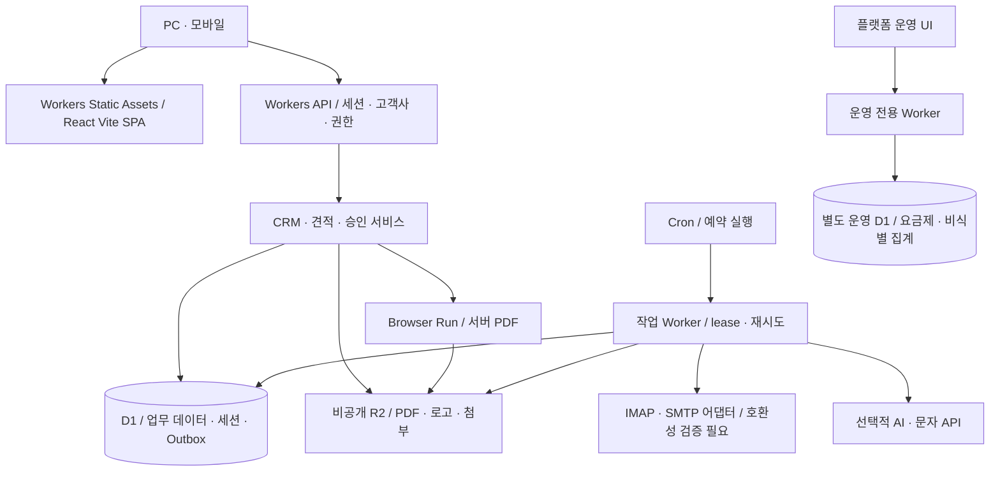
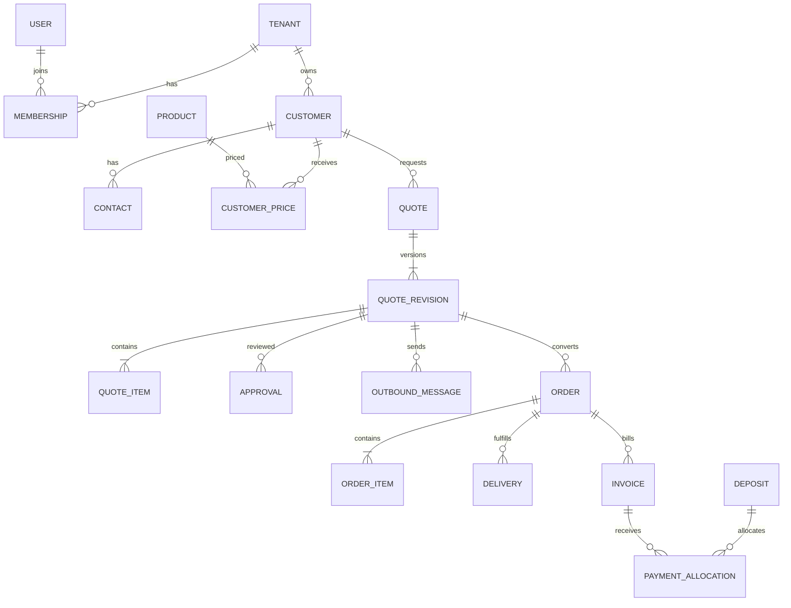

# 의료기기 영업·견적 자동화 SaaS 설계안

작성일: 2026-10-29 · 개정: React(Vite) + Cloudflare D1·R2 · 상태: 기술 아키텍처 확정 / 상세 설계·검증 계획 승인 대기 · 범위: 1단계 설계

이 문서는 개발 제안이며 구현 완료 보고가 아니다. 애플리케이션 코드, 데이터베이스, 외부 계정 연결 및 유료 서비스는 아직 만들지 않았다. 설계 승인 후 2단계 핵심 MVP를 기능별로 구현하고 검증한다.

## 0. 현재 환경 조사

| 항목 | 확인 결과 |
|---|---|
| 작업 위치 | 의료기기업 자동화 플랫폼 / 샘플 작성 |
| 기존 파일 | 프로젝트와 하위 샘플 작성 폴더에 재사용할 코드·설정·데이터 없음 |
| 개발 지침 | 작업 폴더 및 확인한 상위 경로에서 AGENTS.md 발견되지 않음 |
| 실행 환경 | Windows PowerShell |
| Node.js / npm | v24.12.0 / 11.6.2 |
| Python / Git | 3.14.6 / 2.49.0.windows.1 |
| PostgreSQL / Docker | PATH에서 명령을 찾지 못함. PC 전체의 설치 여부나 서비스 가동 여부까지 확인한 것은 아님 |
| 배포 환경 | 사용자 지정: React(Vite), Cloudflare D1·R2. Workers 백엔드 확정; 계정·도메인·리소스는 아직 연결하지 않음 |

개발 시작 시 Node 버전과 선택한 프레임워크·ORM의 호환성을 확인하고 버전과 lockfile을 고정한다. 현재 PC를 상시 운영 서버로 사용하지 않는다.

## 1. 전체 시스템 아키텍처

### 1.1 확정 기술과 권장 구조

사용자가 지정한 React(Vite), D1, R2를 기준으로 한다. 프런트엔드는 React + TypeScript SPA, API는 Cloudflare Workers로 분리하고 동일 도메인의 `/api/*`로 제공한다. 서버 권한 검사·계산·비밀정보 처리는 모두 Worker에서 수행한다. [Cloudflare React + Vite 공식 안내](https://developers.cloudflare.com/workers/framework-guides/web-apps/react/)

| 영역 | 기술 | 역할 |
|---|---|---|
| 프런트엔드 | React + Vite + TypeScript + React Router | 로그인 기반 한국어 업무 SPA |
| UI | Tailwind CSS | PC 표 중심, 모바일 반응형 |
| API | Cloudflare Workers, TypeScript REST API | 인증·권한·계산·업무 처리 |
| 데이터 | Cloudflare D1 | SQLite 기반 관계형 업무 데이터 |
| DB 접근 | D1 prepared statements + SQL migrations | 바인딩 사용, 동시성·배치 동작을 명시적으로 제어; ORM 초기 필수 아님 |
| 파일 | Cloudflare R2 Standard 비공개 버킷 | 견적 PDF·로고·직인·메일 첨부·캡처 |
| 인증 | D1에 토큰 해시를 저장하는 서버 세션 | HttpOnly 쿠키, 즉시 폐기·권한 재검사 |
| 예약 작업 | Cron Triggers + D1 jobs/Outbox | MVP는 모의 작업, 3단계부터 예약 수집·재시도 |
| 확장 큐 | Cloudflare Queues 선택 도입 | 작업량 증가 시 사용, 비용·중복 전달 검증 후 채택 |
| PDF | Workers 호환 PDF 라이브러리 또는 Browser Run 후보 | 한글·표·실행 비용 검증 후 선택, 결과는 R2 저장 |
| 비밀정보 | Workers Secrets + Web Crypto 암호화 | D1 인증정보 암호화 키·외부 API 키 보호 |
| 로컬 개발 | Cloudflare Vite plugin / Wrangler 로컬 D1·R2 | 실제 계정 없이 모의 데이터 테스트 |

예정 구조: `apps/web`(React/Vite 및 API Worker 진입점), `apps/jobs`(예약 작업 Worker), `packages/domain`, `packages/db`, `packages/adapters`, `packages/pdf`, `migrations`, `tests`, `docs`. 패키지 생성은 설계 승인 후 수행한다.

### 1.2 배포·실행 제약

Workers Static Assets에서 Vite 빌드 결과를 제공하고 `/api/*`는 항상 API Worker에서 먼저 처리한다. 인증 오류가 SPA HTML로 바뀌지 않도록 경로를 분리한다. D1·R2·Secrets 바인딩은 서버에만 두며 `VITE_*` 환경변수에는 비밀정보를 넣지 않는다. 개발·검증·운영 환경의 DB·버킷·키를 분리한다. [Static Assets](https://developers.cloudflare.com/workers/static-assets/)

MVP는 별도 VM 없이 Workers·D1·R2를 기본으로 한다. PDF는 Workers 호환 라이브러리를 우선 검토하고 품질·실행 한도상 필요하면 Browser Run을 사용한다. 일반 Node Chromium 프로세스를 Worker 내부에서 직접 실행하는 구조는 사용하지 않는다. 로컬에서는 동일 HTML을 로컬 브라우저로 검증하고, 배포 전 선택한 엔진의 실제 Workers 실행·한글 폰트·페이지 나눔을 별도 검증한다. [PDF 기능 및 요금](https://developers.cloudflare.com/browser-run/pricing/)

네이버 메일은 IMAP 993/TLS, SMTP 587/STARTTLS 및 MIME·첨부 스트리밍을 승인 후 초기에는 Workers의 실제 TCP·TLS 연결을 탐색하고, 계정 인증·발송·반복 실행은 테스트 계정 준비 후 3단계 본 구현 전에 검증한다. Workers의 기본 SMTP 25번 차단이 587번 불가를 의미하지는 않지만 일반 Node 메일 라이브러리가 그대로 동작한다고 가정하지 않는다. 실패할 때만 별도 메일 실행기 도입을 제안한다. 그 경우에도 DB·파일은 D1·R2를 유지하고 실행기는 범위가 제한된 인증 API로 통신한다. Cloudflare 이메일 라우팅은 네이버 사서함 IMAP 수집의 대체 기능으로 간주하지 않는다. [TCP 제약](https://developers.cloudflare.com/workers/runtime-apis/tcp-sockets/)

Cron은 UTC 기준이다. 한국시간 09·12·15·18시 수집은 UTC 00·03·06·09시이며 계정별 작업으로 나눠 체크포인트를 저장한다. 예약 실행과 실패 재시도 일정은 분리한다. [Cron](https://developers.cloudflare.com/workers/configuration/cron-triggers/), [실행 제한](https://developers.cloudflare.com/workers/platform/limits/)

D1은 유료 기준 DB 하나당 최대 10GB, 무료는 500MB이다. 첨부·메일 원문·PDF는 R2에 두고 D1에는 참조와 검색용 필드만 저장한다. 고객사·날짜·상태 복합 인덱스로 전체 테이블 스캔을 줄인다. 초기 업무 D1 하나에 고객사를 논리 분리하되 용량·처리량 임계 도달 전 고객사 단위 DB 분할을 검토한다. DB 간 FK·원자적 트랜잭션은 가정하지 않는다. [D1 제한](https://developers.cloudflare.com/d1/platform/limits/)

### 1.3 업무 흐름과 변경 불가 규칙

1. 수동 요청 또는 메일 수집 → 요청 기록 → 제품 후보 확인 → 견적 초안.
2. 거래처별 단가 우선, 없으면 제품 기본단가. 적용 가격·세율·제품 설명·회사 및 거래처 정보를 견적 버전에 복사한다.
3. 초안 → 승인 대기 → 승인 완료 → 발송 기록 → 주문 확정 / 미구매 / 만료.
4. 반려는 사유와 함께 초안으로 복귀. 승인 후 수정은 새 버전을 만들고 기존 승인을 무효화한다. 이미 발송한 버전과 PDF는 유지한다.
5. 발송 승인 대상은 견적 버전뿐 아니라 수신자·제목·본문·첨부 해시를 포함한다. 승인 뒤 변경하면 재승인한다.
6. 발송과 주문·청구·수금은 별개다. 메일 발송 이벤트는 매출이나 미수금을 만들지 않는다.
7. 주문에서 부분 납품과 청구를 별도 생성한다. 미수금은 확정 청구액에서 수금 배정·유효한 감액을 차감해 계산한다.
8. 입금 검토 승인과 청구 배정은 D1의 한 원자적 batch와 제약 검증으로 처리한다. 취소는 삭제가 아니라 반대 기록으로 남긴다.

## 2. 데이터베이스 테이블 및 관계

### 2.1 공통 규칙

- PK는 UUID를 저장하는 TEXT. 고객사 업무 테이블에는 `tenant_id NOT NULL`, 생성·수정 시각 및 작성자를 둔다.
- 부모 테이블의 `(tenant_id, id)`에 UNIQUE, 자식은 `(tenant_id, parent_id)` 복합 FK를 사용한다. 다른 고객사의 거래처·파일·직원이 연결되는 것을 DB에서도 막는다.
- 시각은 UTC epoch milliseconds INTEGER, 업무 일자는 YYYY-MM-DD TEXT로 저장한다. 화면·월 사용량·일정 경계는 Asia/Seoul 기준이며 BOOLEAN은 0/1 CHECK, JSON은 검증된 TEXT로 표현한다.
- 확정 금액은 원 단위 INTEGER, 단가에 소수점이 필요하면 1/100원 스케일 정수, 수량은 1/1000 단위 정수, 세율은 basis point 정수로 저장한다. 계산 중간값은 BigInt/정확한 십진 연산을 사용하고 반올림은 명시적으로 수행한다. D1 JS 바인딩의 안전 정수 범위를 넘지 않게 입력·누계 상한을 검증한다. SQLite NUMERIC을 고정 소수점 보장으로 간주하지 않는다.
- 문서번호는 고객사·문서유형·연도별 카운터 증가와 문서 삽입을 한 D1 batch 안에서 SQL로 처리한다. `MAX+1` 금지, `(tenant_id, document_no)` UNIQUE.
- 과거 문서의 가격을 현재 제품 테이블에서 다시 계산하지 않는다. FK 삭제는 제한하고 거래 이력이 있는 거래처·제품은 보관 상태로 전환한다.
- 아래는 전체 논리 설계다. 단계 3~6 테이블은 해당 단계에서 마이그레이션한다.

### 2.2 D1 동시성·원자성 규칙

D1 `batch()`는 문장 실패 시 전체 롤백되는 SQL 트랜잭션이다. JS에서 읽은 값을 바탕으로 여러 독립 호출을 실행하는 흐름은 원자적이지 않다. `SELECT FOR UPDATE`나 일반 서버 ORM의 대화형 트랜잭션을 전제로 설계하지 않는다. [D1 batch 문서](https://developers.cloudflare.com/d1/worker-api/d1-database/)

- 변경은 `tenant_id + id + expected_version + expected_status` 조건으로 수행하고 성공 시 버전을 증가시킨다. 조건 미일치 0행 갱신은 SQL 오류가 아니므로 단순히 batch로 묶는 것만으로 후속 쓰기를 막을 수 없다.
- 승인·수금·한도 예약처럼 연관 쓰기가 있는 작업은 조건과 합계 한도를 DB 트리거/제약으로 검사하고 위반 시 ABORT시켜 전체 batch를 롤백한다. 실패한 선행 조건 뒤에 감사·배정·발송 Outbox만 저장되지 않는지 테스트한다.
- 단가 적용기간 중첩은 고객사·제품·거래처 범위의 INSERT/UPDATE 트리거로 검사한다. 견적 번호 카운터 증가 후 같은 batch의 INSERT SELECT에서 번호를 사용한다.
- 작업 획득은 만료 조건과 lease 토큰을 포함한 조건부 UPDATE로 수행한다. 완료·연장 시 토큰을 재검사하고 오래된 작업자가 새 작업 결과를 덮어쓰지 못하게 한다.
- D1과 R2는 하나의 트랜잭션이 아니다. 파일 메타데이터를 pending으로 기록 → R2 저장 → 해시 확인 후 ready 전환한다. 실패·고아 객체는 재시도와 정리 작업으로 회수하며 ready 파일만 다운로드·첨부한다.
- MVP는 읽기 복제를 비활성으로 시작한다. 이후 도입 시 Sessions API/bookmark 일관성을 검증하고 인증·승인·수금의 최신 상태를 보장한다.

### 2.3 테이블 목록

| 테이블 | 주요 컬럼·제약·관계 | 도입 |
|---|---|---|
| tenants | 회사명, 상태, 가입일, timezone | MVP |
| users | 이메일 UNIQUE, password_hash, 상태; 전역 로그인 식별자 | MVP |
| memberships | tenant_id, user_id, role, 상태; 고객사·사용자 UNIQUE | MVP |
| role_permissions | tenant_id, 역할, permission; 서버 권한 정책 | MVP |
| sessions | 토큰 해시 UNIQUE, user_id, 선택 membership, 만료·폐기 시각 | MVP |
| auth_tokens | 초대·재설정 토큰 해시, 만료, 일회용 사용 시각 | MVP |
| company_profiles | tenant_id UNIQUE, 사업자번호·대표·주소·연락처, 로고·직인 파일 FK | MVP |
| quote_templates | 회사별 템플릿 버전, 기본 조건, 폰트·표시 설정 | MVP |
| customers | 거래처명, 사업자번호, 대표·주소·전화, 구분·거래상태, 담당 membership, 메모 | MVP |
| customer_contacts | customer_id, 담당자명, 휴대전화, 이메일, 대표 여부 | MVP |
| products | 코드, 제품명·모델·제조사·수입사·품목·규격·포장, 세금구분, 판매상태; 고객사·코드 UNIQUE | MVP |
| product_price_versions | product_id, 단가, 포함/별도 VAT, 유효기간, 변경자·사유; 적용기간 중첩 방지 | MVP |
| customer_prices | customer_id, product_id, 단가, 세금구분, 적용기간, 변경사유; 기간 중첩 방지 | MVP |
| quote_requests / request_items | 수동·메일 출처, 고객사, 거래처, 요청 제품·수량·납기, 확인 상태; 자동 확정 불가 사유 | MVP 수동 / 3 |
| quotes | 고객사별 견적번호, customer_id, request_id, current_revision_id, 업무 상태, version 충돌 검사 | MVP |
| quote_revisions | quote_id, revision_no UNIQUE 범위, 작성일·유효일, 공급자·수신자 스냅샷, 조건, 합계, PDF 파일·해시 | MVP |
| quote_items | revision_id, 순서, product_id, 설명·모델·규격 스냅샷, 수량·단가·세율·세액·공급가·가격 출처 | MVP |
| approvals | 대상 revision, 요청·승인·반려, 요청자·결정자·시각·사유, 승인 범위 해시 | MVP |
| outbound_messages | revision_id, 수신자·본문 스냅샷, reply 헤더, 채널, 환경(mock/live), idempotency_key UNIQUE 범위 | MVP 모의 / 3 |
| delivery_attempts | outbound_id, 시도번호, 상태, SMTP 응답, 수락 시각, 결과 불명 여부, 비식별 오류 | MVP 모의 / 3 |
| files | tenant_id, 비공개 object_key UNIQUE, 원본명, MIME, 크기, 해시, 검사 상태, 보존 분류 | MVP |
| document_sequences | tenant_id, 유형, 연도, next_value; 조합 UNIQUE | MVP |
| audit_events | tenant_id, actor, action, 대상 ID·버전, 시각, 최소 변경 정보; 추가 전용 | MVP |
| jobs / outbox_events | tenant_id, 작업유형, 참조 ID, 중복 키, 상태·시도횟수·다음 실행·lease; 중복 키 UNIQUE | MVP PDF·모의 / 3 확장 |
| mail_accounts | tenant_id, 계정명, 암호화 인증정보·키버전, 연결 상태·최근 수집·오류 | 3 |
| mailboxes | account_id, mailbox 식별자, UIDVALIDITY, 마지막 UID·체크포인트 | 3 |
| inbound_emails | account_id, mailbox, UIDVALIDITY, UID, Message-ID, 본문 파일 참조, 날짜·발신자 | 3 |
| email_attachments | email_id, file_id, 파싱·검사 상태 | 3 |
| analysis_runs | email_id, 추출 JSON, 제품 후보, 불명확 사유, 검토자, 모델·스키마 버전 | 3 |
| ai_usage_events | tenant_id, 요청 키, 모델, 입력·출력 토큰, 추정·확정 원가, 예약·확정·해제 상태 | 3 |
| orders / order_items | quote_revision_id, 주문번호, 결제조건(선입금/후불), 상태; 품목·수량·가격 스냅샷 | 4 |
| deliveries / delivery_items | order_id, 예정·완료일, 출고 상태, order_item_id별 납품 수량 | 4 |
| invoices / invoice_items | customer_id, order_id, 청구번호·일자·기한·상태·금액, 청구 수량 | 4 |
| deposits | 은행·입금일시·입금자·금액·거래 ID, 알림 원문/파일, 중복 의심 키, 검토 상태 | 4 |
| payment_allocations | deposit_id, invoice_id, 배정액, 승인자·시각; 총 배정액 한도 검사 | 4 |
| receipt_reversals / credit_notes | 원 수금배정/청구 참조, 취소·감액액, 사유, 승인자; 회계 기록 보존 | 4 |
| order_adjustments / return_items | 주문·품목 참조, 취소·반품 수량, 사유·처리 상태 | 4 |
| bank_reconciliations | 은행내역 가져오기 ID, 입금 참조, 대조·차이·확인자 | 4 후속 |
| payer_aliases | customer_id, 입금자 별칭, 확인자 | 4 |
| sales_activities / customer_interests | 거래처·담당자, 활동일·유형·메모 / 관심 제품 | 5 |
| consent_events | contact_id, 채널·목적, 동의/철회, 시각·수집경로·문구 버전·증빙 | 5 |
| messaging_accounts / sender_numbers | 고객사별 암호화 키, 제공자, 검증된 발신번호·검증 상태 | 5 |
| message_campaigns / message_recipients | 목적·템플릿·예약시각, 대상자, 발송 시 동의 검증 결과, 단가·상태 | 5 |
| plans / plan_entitlements | 전역 요금제·버전, 기능·메일계정·AI 한도 | 6; MVP는 설정값 |
| subscriptions / usage_counters | tenant_id, 요금제·기간, 지표별 사용·예약량; 청구월 조합 UNIQUE | 6; AI 한도는 3에서 선행 |
| platform_admins / support_access_grants | 운영 관리자 / 고객사 승인 기반 제한적 지원 접근·만료·사유 | 6 |

메일 UNIQUE 키는 `(tenant_id, account_id, mailbox, uidvalidity, uid)`이다. Message-ID만으로 중복 판정하지 않는다. UIDVALIDITY가 바뀌면 재동기화하고 해시·헤더로 중복 의심을 분류한다.

### 2.4 핵심 관계

초기 주문 전환은 견적 버전당 주문 1개로 제한하고 UNIQUE 제약으로 중복 생성을 막는다. 여러 주문으로 분할하는 기능은 후속 확장으로 둔다. 입금 한 건은 여러 청구서에, 청구서 한 건은 여러 입금에 연결할 수 있다. 미배정 선입금은 거래처의 선수금으로 표시하고 매출·수금배정과 구분한다.

## 3. 화면별 메뉴와 기능 명세

공통 화면은 상단 회사명·사용자·모의환경 표시, 좌측 12개 메뉴, 검색·필터·페이지 이동·빈 상태·오류 및 재시도 안내로 구성한다. PC에서는 목록과 상세를 함께 보며 모바일에서는 카드 목록과 상세 화면으로 전환한다. 미구현 메뉴는 ‘3단계 예정’처럼 표시하고 실행 버튼을 제공하지 않는다.

| 메뉴 | 핵심 화면 및 동작 | 1차 MVP 표시 |
|---|---|---|
| 대시보드 | 승인 대기, 견적 건수·금액, 만료 예정, 후속 단계의 주문·청구·수금 카드 | 견적 지표만 실제 계산; 나머지는 예정 표시 |
| 견적 요청함 | 요청 목록·상세, 원문, 제품 후보, 수량·납기 검토, 초안 만들기 | 수동 입력과 모의 요청; 자동 수집 비활성 |
| 견적서 관리 | 목록·상태 필터, 편집, 버전 비교, 승인·반려, PDF, 발송 이력 | 핵심 기능; 모의 발송은 ‘테스트 수락’ 표시 |
| 주문·납품 관리 | 견적에서 주문 전환, 부분 출고·납품, 청구, 취소·반품, 거래명세서 | 4단계 예정 |
| 거래처 CRM | 기본정보·담당자·영업담당, 견적 타임라인, 잠재고객 상태 | 기본정보·견적 이력; 구매·활동 기록은 단계 구분 |
| 제품·단가 관리 | 제품 등록·검색·상태, 거래처별 단가, 적용기간, 변경 이력 | 사용 가능 |
| 입금·미수금 관리 | 문자 붙여넣기·캡처, 추출값 확인, 대조 후보, 승인·배정·취소 | 4단계 예정 |
| 이메일 관리 | 연결·테스트·해제, 수동 수집, 최근 성공·오류, 발송 이력 | 모의 발송 이력만; 네이버 연결은 3단계 예정 |
| 문자·카카오톡 관리 | 계정·발신번호 검증, 정보/광고 분리, 동의·발송·원가 | 5단계 예정 |
| 매출·영업 통계 | 요청·발송·전환, 주문·납품·청구·수금 별도 집계, 거래처·제품별 통계 | 견적 통계만; 실제 매출 그래프 표시 금지 |
| 회사 설정 | 공급자 정보, 로고·직인, 견적 기본조건·양식, 요금제·사용량 | 회사정보·기본 양식 1종 |
| 직원·권한 관리 | 직원 초대·중지, 역할·승인권한, 감사이력 | 관리자·직원 기본 권한 |

로그인·로그아웃·초대 수락·비밀번호 재설정은 별도 인증 화면이다. 플랫폼 운영 화면은 별도 경로와 권한으로 분리하며 고객사의 영업 상세 검색을 제공하지 않는다. 공개 셀프 가입·자동 결제는 6단계로 미룬다.

견적 작성 화면 순서: 거래처 선택 → 제품 검색 → 단가 출처 표시 → 수량·조건 입력 → 합계 검토 → 저장 → 승인 요청. 제품 코드가 없거나 모델명이 여러 제품과 일치하면 후보 선택을 필수로 요구한다.

## 4. 고객사별 데이터 분리 및 보안

### 4.1 접근 권한

| 작업 | 플랫폼 관리자 | 고객사 관리자 | 일반 직원 기본값 |
|---|---|---|---|
| 고객사 가입·요금제·총사용량 | 허용 | 자기 회사 조회 | 불가 |
| 거래처·제품·견적 상세 | 기본 불가 | 자기 회사 허용 | 자기 회사 업무 범위 허용 |
| 견적 작성·승인 요청 | 불가 | 허용 | 허용 |
| 견적 승인·수금 확정 | 불가 | 허용 | 불가; 별도 권한 부여 시 허용 |
| 승인 문서 발송 요청 | 불가 | 허용 | 발송 권한 필요 |
| 메일·문자 인증정보 설정 | 불가 | 허용, 저장 후 원문 조회 불가 | 불가 |
| 직원·회사 설정 | 불가 | 허용 | 불가 |
| 지원 접근 | 고객사 승인·시간 제한·감사 필수 | 승인·철회 | 불가 |

직원은 초기에는 회사 내 공동 영업자료를 조회하는 기본안을 제안한다. 담당 거래처만 조회하는 정책이 필요하면 서버의 고객사·담당자 범위 조건을 함께 추가한다. 자기 작성 견적의 자기 승인은 기본 금지하며 1인 회사만 관리자 설정으로 허용하고 감사로그를 남기는 안을 검토한다.

### 4.2 격리 구현 원칙

- D1은 PostgreSQL RLS를 제공하지 않는다. 고객사 격리의 핵심 책임은 API·데이터 접근 계층에 있다. 복합 FK는 타사 연결을 막지만 필터 없는 SELECT의 정보 노출을 막지는 못한다.
- 서버 세션에서 활성 membership과 권한을 확인해 tenant context를 생성한다. 클라이언트가 보낸 tenant_id를 그대로 사용하지 않는다.
- 모든 조회·검색·JOIN·수정·삭제·집계는 tenant context를 필수로 받는 데이터 접근 함수를 통한다. context가 없으면 실패한다. UPDATE/DELETE에도 tenant_id 조건을 반드시 넣는다.
- 업무 API에서 raw D1 바인딩을 직접 쓰는 경로를 제한한다. 준비된 문장과 바인딩으로 SQL 인젝션을 방지하고, 리뷰·정적 규칙·A/B 고객사 공격 테스트로 필터 누락을 검증한다.
- 모든 API·다운로드·보고서·작업에서 동일한 권한 정책을 사용한다. UI 버튼 숨김만으로 제한하지 않는다.
- 플랫폼 운영 Worker에는 업무 D1과 R2 바인딩을 주지 않는다. 별도 운영 D1에 요금제·고객사 상태·비식별 집계만 두고 서버 간 인증된 API로 동기화한다. 업무 변경과 집계 전송은 Outbox 재시도로 연결한다. DB 간 관계는 FK 대신 서버 검증을 사용한다.
- 계정 소유자·배포 관리자는 기술적으로 자료 접근 가능성이 있으므로 Cloudflare 계정·배포 토큰의 최소권한과 접근 감사도 적용한다.
- 캐시 키·작업 키·파일 경로에 tenant_id 포함. 민감 데이터는 공유 캐시 금지. R2의 접두어는 권한 경계가 아니므로 다운로드마다 D1의 파일 소유자·권한을 확인한다.

### 4.3 인증·파일·비밀정보

- 세션 쿠키는 HttpOnly, Secure, SameSite 적용. 토큰 원문 대신 해시 저장, 로그인 시 회전, 만료·퇴사·비밀번호 변경 시 폐기.
- 비밀번호 해싱은 Workers에서 실행 가능한 검증된 구현을 선택하고 CPU·메모리·해시 강도를 측정한다. Argon2id WASM 등 후보의 실제 호환성 확인 전 확정하지 않으며, 빠른 단순 해시로 대체하지 않는다. 로그인·재설정 속도 제한, CSRF/Origin 검사, 출력 이스케이프, 서버 입력 검증.
- 메일 본문은 스크립트 제거 후 표시하고 원격 이미지 자동 로딩 차단. PDF 렌더러는 외부 URL 접근과 임의 파일 읽기를 금지한다.
- 파일 업로드는 허용 형식·실제 MIME·크기 제한·악성파일 검사·격리 처리. 파일명으로 저장 경로를 만들지 않는다.
- 다운로드 요청마다 회사와 객체 권한 확인. 짧은 만료의 서명 URL 또는 인증 스트리밍 사용. 로고·직인도 비공개 보관한다.
- 외부 인증정보는 인증 암호화(AES-GCM 등)와 키 버전을 사용하고 암호화 키는 Workers Secrets에 두어 DB와 분리한다. 브라우저·로그·소스·백업 본문에 키 노출 금지.
- 연결 해제 시 작업 중단 및 저장 인증정보 삭제. 백업 잔존 비밀정보의 보존·폐기와 공급자 측 비밀번호 폐기 안내도 정책에 포함한다.
- 감사로그는 추가 전용으로 승인·다운로드·권한 변경·지원 접근 등을 기록하되 메일 원문·비밀번호를 넣지 않는다.

### 4.4 중복·동시 실행·외부 장애

SMTP는 공급자가 수락한 직후 연결이 끊기면 결과를 확정할 수 없다. ‘정확히 한 번 발송’을 보장한다고 표시하지 않는다. Outbox와 발송 잠금으로 자체 중복은 막고, 수락 여부가 불명확하면 자동 재발송을 멈춰 담당자 확인을 요청한다. 수락은 배달 완료와 구분하며 반송을 확인하면 별도 상태로 기록한다.

수집 작업은 계정별 lease와 체크포인트를 사용한다. 메일 저장 성공 후 체크포인트를 전진시키며 UID 고유 제약으로 재시도를 허용한다. 인증 오류는 반복 재시도하지 않고 연결 재설정을 알린다. 일시 오류는 횟수 제한·지수 백오프·최종 실패함으로 관리한다.

입금은 거래 ID가 있으면 강한 중복 키로 사용한다. 거래 ID가 없을 때 은행·시각·금액·입금자 해시는 ‘중복 의심’으로만 취급한다. 동일 금액의 실제 입금 두 건을 임의로 합치지 않으며 중복 예외 승인 사유를 기록한다. 수금 배정과 승인 시 D1 batch·합계 검증 트리거·중복 키로 초과·이중 배정을 막는다.

### 4.5 AI·개인정보·백업

메일 분류·제품코드 검색·가격 계산은 일반 코드로 처리한다. 애매한 요청만 최소 본문을 정제해 AI에 전달한다. 서명·계좌·연락처는 가능한 한 제거하고 첨부는 기본 미전송한다. 메일에 포함된 지시는 데이터로만 취급하며 AI에 발송·DB 변경 도구 권한을 주지 않는다.

AI 결과는 JSON 스키마와 DB 후보로 검증하고 가격 필드를 신뢰하지 않는다. 월 한도는 호출 전에 원자적으로 예약하고 종료 시 실제 사용량으로 정산한다. 재시도 호출 비용도 기록하며 분석 건수와 공급자 과금 호출 수를 분리한다. 초과 시 수동 처리로 전환한다.

광고 동의는 업무 연락과 별도이고 채널·목적별 이벤트로 보존한다. 광고 발송 시점에 철회·발송시간·표시 요건을 재확인한다. 실제 발송 단계에서 최신 법령·공급자 정책과 국외 이전·보존기간·위탁 계약을 검토해 확정하며, 이 설계만으로 법적 적합성을 확정하지 않는다. 환자 의료정보 수집은 서비스 범위에서 제외한다.

D1 Time Travel은 무료 7일·유료 30일 복구 기간을 제공한다. R2 파일까지 복구하지 않으므로 불변 파일 키·별도 백업과 함께 운영한다. 파일럿 목표: D1 일일 내보내기 및 R2 파일 백업, 별도 권한의 저장 위치, 30일 보관, 월 1회 복구 연습, RPO 24시간·RTO 8시간. [Time Travel](https://developers.cloudflare.com/d1/reference/time-travel/) 상용화 목표는 PITR을 포함한 RPO 1시간·RTO 4시간으로 별도 검증한다. 수치는 SLA 보장이 아닌 목표다. 공유 D1 전체를 한 고객사 복구 때문에 되돌리지 않는다. 격리된 복구용 DB에 지원되는 복원·가져오기 절차로 자료를 준비한 뒤 해당 고객사 레코드와 R2 파일 참조를 함께 검증·반영한다. 실제 복구 절차는 운영 전 시험한다. 장애 알림은 작업 지연·오류율·백업 실패·저장 용량을 대상으로 하며 개인정보를 포함하지 않는다.

## 5. 1차 MVP 개발 범위 및 합격 기준

### 5.1 포함

1. 가상 고객사 A/B와 관리자·직원 계정, 로그인·로그아웃·세션 폐기, 서버 권한 및 D1 고객사 격리.
2. 회사정보·직원 기본 관리, 거래처·담당자 등록·수정·검색·보관.
3. 제품·기본단가·거래처 단가·변경 이력. 실제 사업자번호·연락처 없이 가상 데이터 사용.
4. 수동 요청 등록, 견적 작성·번호·버전·합계·유효기간·조건·승인/반려.
5. 기본 견적서 양식 1종, 로고·직인 업로드, 서버 PDF 및 인증 다운로드.
6. 모의 발송 승인·성공·실패·결과 불명 이력. 모의 결과는 실제 발송 통계에 넣지 않는다.
7. 견적 중심 대시보드, 감사로그, 반응형 UI, 미구현 메뉴의 명시적 표시.

### 5.2 제외

실제 IMAP/SMTP·AI 호출·OCR·주문·청구·수금·문자·카카오·결제·고급 통계·자유 양식 편집기·공개 가입. 모의 발송은 외부 네트워크로 메일을 보내지 않는다. 실 서비스 발송은 3단계의 별도 사용자 승인 이후에만 수행한다.

### 5.3 기능별 검증 게이트

| 순서 | 테스트 | 통과 조건 |
|---|---|---|
| 1 인증·격리 | A/B 계정으로 URL·ID·요청 body·파일·백그라운드 작업의 고객사 변경 공격 | 타사 데이터 조회·변경·연결 불가; 세션 폐기 즉시 반영 |
| 2 CRM·가격 | 등록·유효성·보관, 단가 적용기간 경계, 회사 간 동일 코드 | 거래처 단가 우선, 가격 변경 후 과거 견적 불변 |
| 3 금액 | 수량·면세·과세·VAT 포함/별도·반올림·0/음수 입력 | 서버와 PDF 합계 일치, 잘못된 입력 거부 |
| 4 승인 | 직원 직접 승인 호출, 승인 후 변경, 동시 수정·동시 번호 생성 | 권한 차단·재승인·충돌 안내·번호 중복 없음 |
| 5 PDF | 한글·긴 제품명·여러 페이지·직인·빈 비고·파일 접근 | 잘림·누락 없이 출력, 타사 다운로드 차단 |
| 6 모의 발송 | 연속 클릭·작업 재시도·응답 단절·승인 버전 변경 | 중복 작업 방지, 결과 불명 재시도 중단, 외부 발송 0건 |
| 7 통합 | 로그인→거래처→제품→견적→승인→PDF→모의 이력 | 전체 흐름 통과, 주문·미수금이 생기지 않음 |

검증 도구 후보는 Vitest(계산·상태), Workers 테스트 런타임과 로컬 D1·R2(바인딩·FK·batch·격리), Playwright(UI·PDF)다. 운영 전 별도 원격 D1·R2 검증 환경에서 제약·동시 실행·파일 접근을 재검증한다. 로컬 통과만으로 실제 Cloudflare 검증 완료를 선언하지 않는다. 실패한 기능은 완료로 보고하지 않고 재현 조건·수정·재시험 결과를 기록한다.

## 6. 단계별 일정과 난이도

전제: 개발자 1인 기준의 계획용 작업일, 1주 5일, 요구사항 검토가 지연되지 않는 경우. 사용자 검토·외부 계정 심사·템플릿 승인 대기와 예비 일정은 별도다. 확정 납기나 자동 실행 시간 약속이 아니다.

| 단계 | 예상 작업일 | 난이도 | 완료 기준 |
|---|---:|---|---|
| 1 설계 검토·확정 | 3~5일 | 중상 | 본 설계·가격 계산·권한·범위 승인 |
| 2 핵심 MVP | 15~25일 | 상 | 위 7개 검증 게이트 통과 |
| 3 이메일 자동화 | 10~15일 | 상 | 연결·예약 수집·제품 검토·AI 한도·승인 SMTP·재시도 검증 |
| 4 주문·수금 | 15~25일 | 매우 높음 | 부분 납품·합산/분할 입금·선입금·취소·중복 검증 |
| 5 CRM·메시징 | 10~15일 | 상 | 동의 철회·시간·검증 발신번호·비용·발송 결과 검증 |
| 6 SaaS 상용화 | 15~25일 | 매우 높음 | 요금제·격리 점검·복구 연습·모니터링·운영 문서 |
| 합계 | 68~110일 | 약 14~22주 | 별도 예비 기간 20~30% 권장 |

MVP 세부 순서: 기반·인증·격리 4~6일 → CRM·제품 3~5일 → 견적·승인 4~6일 → PDF·모의 발송 2~4일 → 통합·수정·인수 2~4일.

상기 일정은 유지하되 MVP 첫 검증 항목에 Workers 인증 해싱·D1 batch·PDF 호환성을 포함한다. 3단계에서 메일 실행기 추가가 필요하면 일정과 비용을 재산정한다. 각 기능 완료 후 해당 테스트를 수행하며 다음 기능으로 진행한다. 각 단계 보고에는 완료 기능, 변경 파일, 실행한 테스트와 결과, 남은 문제, 다음 작업을 기록한다.

## 7. 외부 서비스와 예상 비용

2026-10-29 공식 공개 가격 기준. 확정 인프라는 Workers·D1·R2이며 기존 VM·관리형 PostgreSQL 예산은 제외한다. 세금·환율·계정 전체 사용량·초과분은 별도다. 아래 포함량은 고객사마다 새로 생기는 것이 아니다.

| 항목 | 비용·산정 방식 | 적용 |
|---|---|---|
| 로컬 MVP | 로컬 D1·R2 및 모의 어댑터, 유료 API 0원 목표 | 개발 |
| Workers Paid | 기본 월 $5, 월 요청 1천만·CPU 3천만 ms 포함; 초과 요청 $0.30/백만·CPU $0.02/백만 ms | 운영 권장 |
| D1 Paid | 월 읽기 250억 행·쓰기 5천만 행·총 저장 5GB 포함; 초과 읽기 $0.001/백만 행·쓰기 $1/백만 행·저장 $0.75/GB-month | 업무·운영 D1 합산 |
| R2 Standard | 저장 $0.015/GB-month, 무료 저장 10GB; Class A $4.50/백만·B $0.36/백만 요청, 각각 월 무료 100만·1천만 요청 | 파일·백업 |
| Browser Run | 유료 플랜 월 10시간 포함, 초과 $0.09/시간; Browser Sessions 동시 브라우저 월평균 10개 포함·초과 개당 $2 | PDF |
| Cron·Outbox | Worker 실행·D1 읽기/쓰기 사용량에 반영 | 예약·재시도 |
| Queues / 별도 메일 실행기 | MVP 필수 아님. 3단계 호환성·처리량 검증 후 별도 예산 | 선택 |
| 도메인 | 연 2만~4만원 계획 가정, 실제 견적 필요 | 배포 |
| 네이버 메일 | 별도 API 종량 과금은 확인 자료에 없음. 계정 발송 제한·사용 정책 확인 필요 | 3단계 |
| AI·문자·카카오 | 공급자·실사용별 별도, 아래 가상 예산 참조 | 3·5단계 |

출처: [Workers](https://developers.cloudflare.com/workers/platform/pricing/), [D1](https://developers.cloudflare.com/d1/platform/pricing/), [R2](https://developers.cloudflare.com/r2/pricing/), [Browser Run](https://developers.cloudflare.com/browser-run/pricing/). Browser Run Quick Actions는 브라우저 시간만 과금하며 직접 세션 제어는 동시 브라우저 요금도 적용한다.

소규모 파일럿 예: Worker·D1·Browser Run이 포함량 이내이고 R2 총 저장 50GB, 요청 무료량 이내라면 월 $5 + (50−10)×$0.015 = $5.60. 계획용 환율 1달러=1,400원으로 약 7,840원이며 도메인·세금·초과량·AI·문자·별도 메일 실행기는 제외다. 보장 견적이나 요금 상한이 아니다. 월 1만~3만원을 초기 인프라 예산으로 두되 PDF 실행시간·D1 스캔량을 측정해 재산정한다.

네이버 연결은 IMAP `imap.naver.com:993` SSL, SMTP `smtp.naver.com:587` TLS 안내를 기준으로 검증한다. 인증서 검증은 유지한다. [네이버 안내](https://help.naver.com/service/30029/contents/21351?lang=ko&osType=COMMONOS). 문자 공급자 실제 단가는 계약 전 [SENS 요금](https://www.ncloud.com/product/applicationService/sens) 등에서 재확인한다.

AI 예산 예: 입력 2,000토큰·출력 400토큰, 가상 단가 입력 $0.50/백만·출력 $2.00/백만이면 건당 $0.0018, 월 100/500/2,000건은 각각 $0.18/$0.90/$3.60이다. 이는 실제 특정 모델 가격이 아니다. OCR·긴 본문·재시도는 별도이며 모델 선정 시 공식 가격으로 교체한다.

문자 예산 예: SMS 건당 20원이라는 가정이면 1,000건 2만원, 알림톡 건당 10원 가정이면 1,000건 1만원이다. 실제 견적이나 판매 단가가 아니며 LMS·MMS·대체 문자·수신거부 비용은 별도다. 고객사별 원가와 판매 과금을 분리한다.

요금제 제안은 사용자 제시안 그대로 보존한다: 베이직 29,000원(메일 1·AI 100), 프로 59,000원(메일 2·AI 500), 비즈니스 99,000원(메일 5·AI 2,000). VAT 포함 여부와 저장량·직원수·발송 한도는 미정이다. 1차 MVP에서 실제 결제는 하지 않으며, 상용화 전 기능 권한과 한도를 서버에서 검사한다.

## 8. 개발 과정에서 결정할 핵심 사항

| 결정 사항 | 권장 기본안 | 결정 시점 |
|---|---|---|
| 이번 범위 | 본 설계 승인 후 핵심 MVP만 구현 | 개발 시작 전 |
| 데이터베이스·파일 | D1·R2 확정. 로컬 Wrangler 바인딩으로 시작, 운영 리소스 이름·계정·환경 분리 결정 | MVP 시작 |
| 회사 가입 | 초기에는 관리자가 생성·초대, 공개 가입 후속 | MVP 시작 |
| 직원 자료 열람 | 같은 회사 공동 열람; 담당자별 제한 필요 시 설계 추가 | MVP 시작 |
| 승인 정책 | 관리자 승인, 자기 승인 기본 금지, 1인 회사 예외 설정 검토 | MVP 시작 |
| 금액 계산 | 원화·행별 공급가/세액 원 단위 반올림, 과세 10% 기본·면세 별도; 실제 업무 기준으로 승인 | 견적 구현 전 |
| 견적 양식 | 기본 1종, 회사 로고·직인·조건만 설정 | PDF 구현 전 |
| 샘플 정보 | 가상 회사 2곳·가상 직원·거래처·제품 | MVP 시작 |
| 배포·저장 위치 | Workers·D1·R2 구성. 지원되는 데이터 위치 옵션과 국외 처리 정책 확인; 국내 고정 저장 보장으로 간주하지 않음 | 파일럿 전 |
| 네이버 계정 | 연동 방식·인증수단·발송 제한·기존 메일 최초 수집 범위 | 3단계 전 |
| AI 공급자·한도 | 정형 규칙 우선, 분석 전용 모델 1종, 월 한도 초과 시 수동 처리 | 3단계 전 |
| 청구·매출 기준 | 주문·납품·청구·수금 각각 표시, 매출 인식 시점은 회사 회계 정책 확정 | 4단계 전 |
| 은행 대조·OCR | 붙여넣기 우선, 캡처 추출 후 사람 확인; 은행 대조 파일 형식 선정 | 4단계 전 |
| 메시징 | 고객사 개별 계정·검증 발신번호 우선, 광고는 동의 정책 확정 후 | 5단계 전 |
| 상용 운영 | 보존·탈퇴·지원 접근·복구 목표·VAT·약관·요금제 한도 | 6단계 전 |

첫 개발에서는 외부 계정 없이 검증 가능한 수동 견적 흐름부터 완성한다. 고객사 분리와 승인 무효화 규칙을 후순위로 미루지 않는다.

## 9. 이번 단계 결과 및 미해결 사항

- 완료: React(Vite)·Workers·D1·R2로 설계 개정, 폴더·개발도구 조사, 전체 구조·논리 DB·화면·권한·MVP·일정·비용·결정사항 문서 작성.
- 변경 파일: 본 설계 문서와 별도 검증·미해결 사항 기록. 애플리케이션 코드 변경 없음.
- 실행 확인: Node/npm/Python/Git 버전 조회, 폴더 목록과 파일 검색, 상위 AGENTS.md 존재 확인, 외부 공식 문서 확인.
- 테스트 상태: 구현이 없어 기능·보안·부하·PDF 테스트는 미실행. 5.3절은 앞으로 수행할 합격 기준이다.
- 미해결: Workers 인증 해싱·D1 동시성·Browser Run 검증, 승인·반올림 정책, 실제 계정 제약, 최종 공급자 가격, 운영 저장 위치·법무 검토.
- 다음 단계: 사용자가 설계와 MVP 범위를 승인하면 기반·인증·고객사 격리부터 구현하고 통합 테스트 결과를 보고한다.

## 10. 확정 아키텍처 적용

React Router와 Workers REST API를 확정 구성에 추가했다. Next.js·PostgreSQL은 사용하지 않고 파일은 R2에 저장한다. AI는 OpenAI API 등 교체 가능한 외부 모델을 견적 요청 메일 분석에만 선택적으로 사용한다. 상세 검증 게이트·네이버 실제 연결 시험·대안 판정은 `03_확정_아키텍처_및_호환성_검증_계획.md`를 따른다. 기술 선택 확정과 구현 착수 승인은 구분하며 전체 설계·검증 계획 승인 후 구현한다.
