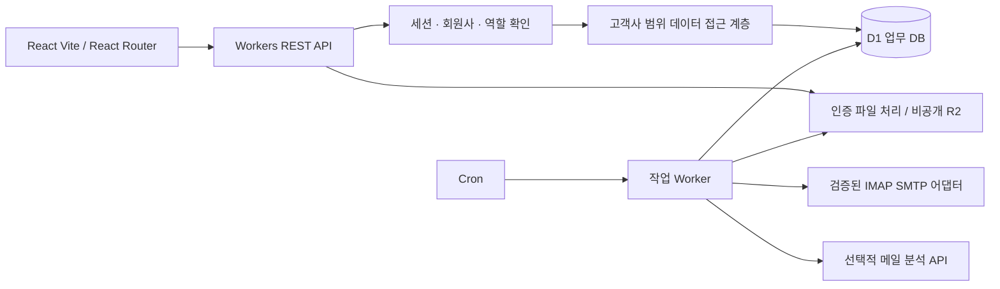

# 확정 아키텍처 및 호환성 검증 계획

기준일: 2026-10-29 · 기술 스택 확정 / 상세 설계·검증 계획 승인 대기

본 문서는 사용자 지정 기술을 확정하고 구현 전 검증 순서를 정한다. 실제 호환성 테스트 결과가 아니다. 전체 테이블·관계·메뉴·권한·일정·비용은 `01_시스템_설계_및_MVP_계획.md`, 미해결 사항은 `02_검증_및_미해결사항.md`에서 관리한다.

## 1. 확정 사항

| 영역 | 확정 기술 및 원칙 |
|---|---|
| 프런트엔드 | React + Vite + TypeScript, Tailwind CSS, React Router, 로그인 기반 반응형 SPA |
| 백엔드 | Cloudflare Workers + TypeScript REST API, 서버 인증·권한 검증 |
| DB | Cloudflare D1(SQLite), 고객사 업무 데이터에 tenant_id, 마이그레이션·백업·복구 |
| 파일 | Cloudflare R2 비공개 버킷, PDF·첨부·입금 캡처·로고·직인, 인증된 접근 |
| 자동화 | Cron Triggers, 한국시간 09:00·12:00·15:00·18:00 수집, 재시도·중복 방지; Queues는 필요할 때 도입 |
| AI | OpenAI API 등을 교체 가능한 어댑터로 연결, 견적 요청 메일 분석에만 선택 사용, 사용량·비용 기록 |
| 계산 | 제품 조회·가격·VAT·합계·한도는 일반 코드와 DB 제약으로 처리 |
| 메일 | Workers TCP·TLS·Node 호환성과 실행 제한을 실제 배포 환경에서 검증한 후 채택 |
| 비밀정보 | Workers Secrets, 서버 암호화 저장, 소스·브라우저·로그에 키·비밀번호 기록 금지 |
| 제외 | Next.js, PostgreSQL, 불필요한 외부 서버·유료 서비스 |

PDF 엔진·인증 해싱 라이브러리·메일 라이브러리는 아직 확정하지 않는다. 기존 설계의 Browser Run은 PDF 후보이며, Workers 내부 PDF 라이브러리와 한글·표·비용을 비교해 가장 단순하게 요구사항을 충족하는 방법을 고른다.

## 2. 전체 설계 요약

- 프런트엔드 경로는 React Router, `/api/v1/*`는 REST API가 처리한다. UI의 접근 제한은 편의 기능이며 실제 권한은 API에서 검사한다. API 오류가 SPA HTML로 대체되지 않도록 배포 라우팅을 검증한다.
- REST 리소스는 세션, 회사, 직원, 거래처, 제품, 단가, 견적, 견적 버전, 승인, 파일, 작업 및 발송 이력으로 구분한다. 주문·수금·요금제는 해당 개발 단계에 추가한다.
- 상태 변경은 명시적 작업 API로 처리한다. 승인·발송 요청 등에는 중복 키와 예상 버전을 사용한다. 서버가 세션에서 고객사를 결정하고 요청의 tenant_id를 신뢰하지 않는다.
- D1의 모든 고객사 업무 테이블·쿼리·복합 FK에 tenant_id를 적용한다. 인증용 전역 사용자 식별자와 공통 요금제 정의는 공유 시스템 데이터로 구분하고 고객사별 가입·사용량에는 tenant_id를 둔다.
- D1은 RLS 기반이 아니다. 필수 tenant context, SQL 바인딩, 타사 ID 공격 테스트, 복합 FK로 격리한다. 운영 관리자 API에는 업무 DB·파일 바인딩을 제공하지 않는 별도 운영 영역을 둔다.
- 원화·수량은 스케일 정수로 저장하고 승인·수금 관련 쓰기는 D1 batch 및 제약으로 원자성을 보장한다. 조건부 UPDATE 0행은 오류가 아니므로 후속 쓰기가 실행되지 않도록 설계·검증한다.
- R2는 파일 원문, D1은 파일 소유자·해시·상태·참조를 보관한다. pending→ready 전이, 고아 파일 정리, 다운로드 권한 검사를 적용한다.
- 첫 MVP는 로그인→거래처·제품→견적→승인→PDF→모의 발송 이력이다. 실제 이메일·AI·주문·수금·메시징은 단계별로 구현한다.

## 3. 승인 후 진행할 호환성 검증

테스트 코드도 승인 후 작성한다. 먼저 작은 검증 프로그램으로 기술 위험을 확인하고 해당 기능의 본 구현을 진행한다. 로컬 검증과 실제 Cloudflare 검증 결과를 구분해 기록한다.

| 순서 | 검증 항목 | 방법 | 통과 기준 |
|---|---|---|---|
| G1 | React/Vite/Router·Workers | 로컬 빌드, SPA 직접 주소·새로고침, API 401/403/404, 모바일 화면 | 라우팅 정상, API가 HTML로 대체되지 않음, 클라이언트 번들에 비밀정보 없음 |
| G2 | 인증·런타임 | Workers 해싱 후보 CPU·메모리, 세션 폐기, CSRF, 권한 변경 테스트 | 선택 플랜 한도 내 실행, 안전한 해싱 기준 충족, 폐기 세션·권한 위반 요청 거부 |
| G3 | D1 | 로컬 및 별도 원격 DB에서 migrations, FK, batch 실패, 동시 버전 변경·번호 발급 | 타사 접근·연결 차단, 중복 번호 0, 중간 실패 전체 롤백, 0행 갱신 후 잔여 쓰기 0 |
| G4 | R2 | 가상 A/B 회사 파일 업로드·다운로드·직접 URL·업로드 중단 | 익명·타사 접근 차단, ready 파일만 사용, 실패 파일 회수 가능 |
| G5 | PDF | Workers 호환 PDF 후보와 필요 시 Browser Run으로 한글·직인·긴 품목·다중 페이지 검증 | 잘림·누락 없음, 서버 금액과 일치, 재생성·권한·원가 확인 |
| G6 | 실제 메일 연결 | 아래 단계별 Workers 원격 테스트 | 인증 전/후·발송 결과를 구분하고 반복 시험 통과 |
| G7 | 예약·중복·장애 | Cron 시각, 중복 작업, lease 만료, UIDVALIDITY 변경, 응답 단절 주입 | 중복 등록·수금·발송 요청 방지, 유한 재시도, 결과 불명 자동 재발송 금지 |
| G8 | 복구·비용 | 검증 DB 내보내기·복구, R2 파일 복구, 읽기/쓰기·CPU·PDF 사용량 측정 | 타사 자료 영향 없음, DB와 파일 참조 일치, 복구 목표·예산 재산정 가능 |

G1~G5는 MVP 초기에 순서대로 수행한다. G6의 인증 없는 연결 탐색도 승인 후 초기 검증에 포함하여 메일 구조 위험을 일찍 확인한다. 인증·실제 발송·반복 수집은 테스트 계정과 실행 범위가 준비된 시점에 수행하고 3단계 본 구현 전에 판정한다. G7은 모의 시험을 먼저, 실제 Cron 확인을 후속 수행한다. G8 복구는 운영 투입 전 필수다.

## 4. 네이버 IMAP/SMTP 실제 검증 계획

### 4.1 준비 및 실행 범위

- 로컬 Node 연결 성공을 Workers 호환성 증거로 대신하지 않는다. 별도 테스트 Worker와 테스트 D1·R2를 사용한다.
- 네이버 테스트 계정은 가상 요청 메일만 가진 전용 사서함을 사용한다. 실제 영업 사서함 전체를 탐색하지 않는다.
- 키와 비밀번호는 사용자가 안전한 비밀정보 입력 경로로 등록한다. 채팅·코드·명령 기록·로그에 평문을 넣지 않는다.
- 실제 메일 발송은 수신주소·제목·내용·건수를 정한 뒤 명시적으로 승인받은 범위만 실행한다. 인증·연결 검증은 발송 검증과 별개다.
- 연결 대상 호스트·포트는 고정된 허용 목록을 사용하고 임의 TCP 프록시를 만들지 않는다. 테스트 API는 인증을 요구한다.

### 4.2 단계별 시험과 증거

| 단계 | 시험 | 성공 증거 및 실패 처리 |
|---|---|---|
| M1 TCP·TLS | `imap.naver.com:993`의 직접 TLS, `smtp.naver.com:587`의 EHLO→STARTTLS→EHLO | 인증서·호스트 검증 유지, 서버 greeting/capability 확인. TLS 전에 자격증명 전송 금지 |
| M2 계정 인증 | 테스트 계정 IMAP/SMTP 인증, IMAP 읽기 전용 사서함 확인 | 인증 성공/실패 코드만 기록, 인증 원문 제외. 실패 시 계정 설정과 런타임 오류 구분 |
| M3 IMAP 수집 | UID·UIDVALIDITY·Message-ID, UTF-8 제목·본문, multipart·첨부 해시, 재수집 | fixture 목록과 동일 건수·해시, 재실행 시 신규 중복 0; 읽음·삭제 플래그를 임의 변경하지 않음 |
| M4 SMTP 발송 | 승인된 소수 테스트 메일에 PDF·답장 헤더 포함 | SMTP 수락 시각·상태와 테스트 수신함 도착을 별도 기록. 발송 수락만으로 배달 성공 표시 금지 |
| M5 장애 주입 | 연결 시간 초과, TLS 실패, 인증 실패, 수락 직후 응답 단절, 작업 재실행 | 일시 실패만 제한 재시도. 인증 오류는 중단. 수락 불명은 확인 필요 상태로 중단 |
| M6 반복·한도 | 하루 4회 실제 Cron, 메일/첨부 상한 경계, 계정별 순차 처리 | 누락·중복 없음, CPU·메모리·연결수·소요시간을 기록하고 제한보다 여유 있는 배치 크기 확정 |

표본 목표는 3일간 12회 예약 수집이며 공급자 제한을 준수한다. SMTP는 매 회 자동 발송하지 않고 승인된 건수만 사용한다. 가상 메일 20건에 한글·빈 본문·중복 Message-ID·첨부·알 수 없는 제품을 포함한다. 첨부 상한은 검증 전 정하고 상한 초과 시 검토 대기로 처리한다. 이 표본 통과는 장기 가용성 보장이 아니며 파일럿 모니터링을 계속한다.

### 4.3 Workers 단독 운영 판정

Workers 단독 채택 조건: 실제 원격 M1~M6 통과, 프로토콜·한글·첨부 처리 정상, 중복 방지 및 안전한 재시도 확인, 측정한 배치가 Workers 제한 이내, 인증정보 비노출.

원인이 잘못된 계정 설정·라이브러리 버전·배치 크기인 경우 먼저 수정한다. TLS/소켓 호환성 또는 반복 실행 제한 때문에 안정성을 확보할 수 없으면 검증 결과와 재현 조건을 보고하고 메일 전용 실행기 대안을 제시한다. 한 번의 일시 장애만으로 외부 서버를 추가하지 않는다.

대안 범위는 IMAP/SMTP만이다. 프런트엔드·REST API·D1·R2는 유지한다. 실행기는 제한된 서버 간 API로 작업을 받고 결과를 반환하며 전체 DB 관리 키를 갖지 않는다. 인증정보 전달·보관·폐기, 추가 월비용, 배포·장애 대응을 별도 설계하여 승인 후 도입한다.

## 5. 라이브러리·비용 선택 기준

- React Router는 SPA 라우팅에 사용한다. REST 요청·업무 상태·서버 권한 검증과 분리한다.
- Cloudflare Vite plugin과 Wrangler의 호환 버전 및 Worker compatibility_date를 검증 후 고정한다. Node 호환 플래그를 켰다는 이유만으로 모든 Node 패키지가 실행 가능하다고 판단하지 않는다.
- DB는 D1 API와 SQL 마이그레이션을 기본으로 한다. ORM은 실제 도움이 있고 D1 batch를 정확하게 지원할 때만 추가한다.
- 메일 라이브러리는 TCP/TLS·스트림·MIME·첨부·타임아웃 테스트를 통과한 후보를 선택한다. 불필요한 자체 IMAP/SMTP 전체 구현은 피한다.
- PDF는 한글 품질·표 페이지 처리·Workers CPU·번들 크기·추가 비용을 비교한다. 비용을 이유로 출력 검증을 생략하지 않는다.
- AI 호출은 3단계 전까지 모의 어댑터로 대체한다. 공급자 선정 전 실제 호출하지 않으며 키는 서버에만 둔다.
- Queues는 처리량·재시도 운영상 이점이 확인될 때만 도입한다. 이메일 자동화가 실패했다고 웹·DB까지 외부 서버로 옮기지 않는다.

## 6. 보고 및 현재 상태

각 검증 결과에는 항목 ID, 실행 환경, 고정 버전, 테스트 데이터·명령, 기대값, 실제 결과, 실패 원인, 원가, 다음 조치를 기록한다. 로그에는 메일 원문·연락처·비밀번호를 남기지 않는다.

현재 완료: 확정 기술 반영, 전체 설계 갱신, 검증 순서·합격 기준 작성, 공식 문서 검토.

현재 미실행: 애플리케이션·검증 코드 작성, 패키지 설치, 원격 리소스 생성·배포, 실제 TCP·계정 인증·메일 발송, 기능·보안·부하 테스트.

다음 단계: 전체 설계와 이 검증 계획 승인 후 G1~G5 및 메일 연결 탐색부터 진행한다. 실제 메일 테스트에 필요한 계정·수신자 정보는 해당 실행 단계에서 안전한 방법으로 준비한다.

공식 검토 자료: [Workers TCP Socket API](https://developers.cloudflare.com/workers/runtime-apis/tcp-sockets/), [Node.js 호환성](https://developers.cloudflare.com/workers/runtime-apis/nodejs/), [Workers 실행 제한](https://developers.cloudflare.com/workers/platform/limits/). 문서상 지원과 실제 네이버 연결 성공은 구분한다.
